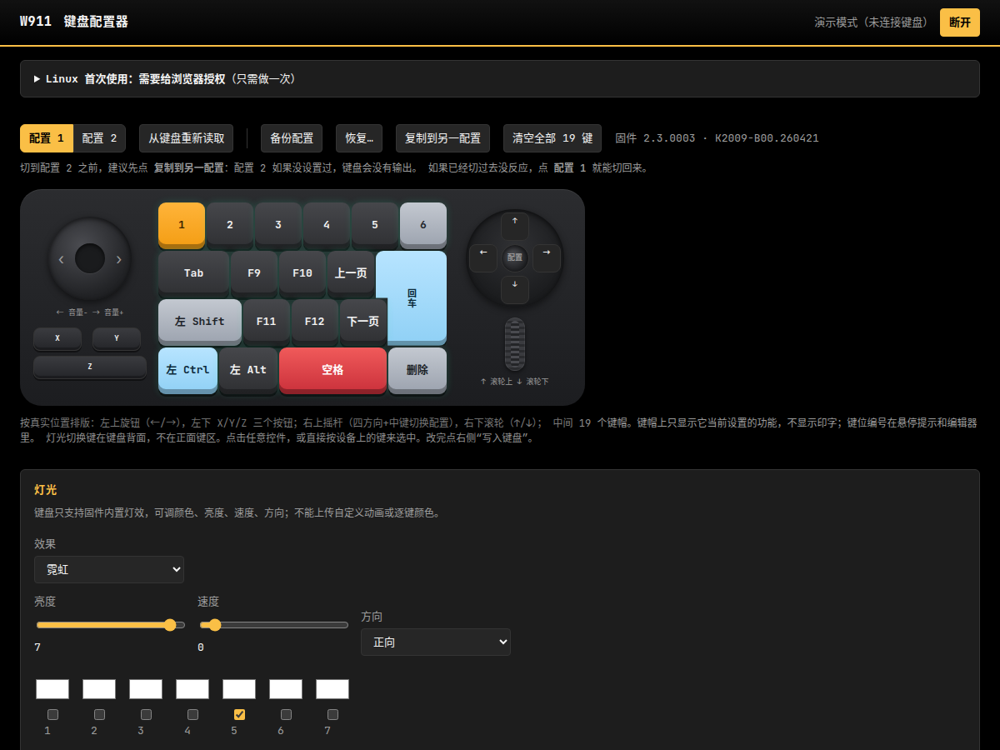

# W911 Linux 配置器

在线使用（GitHub Pages）：<https://ker0491.github.io/w911-linux-configurator/>


W911（SXS-W911 / USB 名称 `K100 Keyboard`，VID:PID `b6a4:4100`）的网页版改键工具。
不用安装 Windows 驱动，Chrome/Edge 打开一个网页就能改键、改旋钮、写宏和调灯光。

## 平台支持

**网页配置器本身是跨平台的**：Windows、macOS、Linux、ChromeOS 上的 Chrome / Edge / Brave /
Opera / Vivaldi 都可以用。Firefox 和 Safari 没有 WebHID，不能用；Android / iOS 不保证。

- **Linux**：需要装一次 udev 规则；`start.sh` 和 `tools/monitor.py` 是 Linux 专用。
- **Windows / macOS**：不需要驱动，也不需要 udev；用 Chromium 浏览器打开页面，
  插 USB 线直接连接即可。Windows 上如果开着厂商的 SXS 程序，先退出（它会占用设备）。
- 配置必须走 **USB 线**；配置完成后，键盘插到任何电脑/系统都能用（设置存在键盘里）。

仓库名里的 “Linux” 是因为项目最初在 Linux 上做的；网页部分并不限于 Linux。

W911 和 W909 使用同一套厂商 HID 协议。本工具是在 W909 配置器的基础上，按 W911 的
19 键布局改的；已经在 W911 固件 `2.3.0003`（板号 `K2009-B00.260421`）上验证过读取和写入。

页面按实物图排版和配色：**左上旋钮（点圆的左/右半边），左下 X/Y/Z 三个按钮；右上摇杆（四方向+中键），
右下滚轮（点滚轮的上/下半边）；中间 19 个键帽（含右侧两行高、左上角有缺口的 7 字形 ENTER）**。
键帽上只显示当前设置的功能，不显示印字/默认值；LED 指示灯不显示。X/Y/Z、旋钮、摇杆、滚轮的相对尺寸也按实物排。摇杆中键切换配置，灯光切换键在键盘背面。点哪个就改哪个；也可以直接按设备上的键，页面会高亮。



## 快速开始

1. 用 **USB 线**把 W911 接到电脑。配置必须走 USB；2.4G / 蓝牙只能使用，不能改设置。
   很多这类键盘用 C-to-C 线不会亮，请优先用 **A-to-C** 线。
2. 运行：

   ```bash
   cd w911-linux-configurator
   ./start.sh
   ```

   或者手动启动：

   ```bash
   python3 -m http.server 8765
   ```

   然后用 Chrome 打开 <http://localhost:8765/>。
3. 点右上角 **连接键盘**，在浏览器弹出的列表里选择 **“K100 Keyboard”**
   （有些系统显示为 “W911 Pro USB”）。如果列表里有多个同名项，逐个试。
4. 连接后会从键盘读出当前配置。点键盘上的任意键（或直接按设备上的键）选中它，
   在右侧选功能，点 **写入键盘**。
5. 改之前建议先点 **备份配置**，它会导出 JSON 文件。以后可以用 **恢复…** 还原。
   如果想从头设置，点 **清空全部 19 键**；它只清空中间 19 个键，X/Y/Z、摇杆、旋钮、滚轮
   和灯光不变。清空后建议重新备份。

## Linux 权限

如果浏览器能看见设备但连接失败，通常是 `/dev/hidraw*` 权限问题。执行一次：

```bash
sudo tee /etc/udev/rules.d/70-w911.rules <<'EOF'
SUBSYSTEM=="hidraw", ATTRS{idVendor}=="b6a4", ATTRS{idProduct}=="4100", MODE="0660", TAG+="uaccess"
SUBSYSTEM=="hidraw", ATTRS{idVendor}=="b6a4", ATTRS{idProduct}=="4101", MODE="0660", TAG+="uaccess"
EOF
sudo udevadm control --reload-rules && sudo udevadm trigger
```

然后拔插一次键盘。

> Snap / Flatpak 版 Chromium 可能被沙箱挡住，打不开 hidraw；请用 deb 版 Chrome/Chromium。

## 能改什么

- **单键**：任意 HID 键盘按键（含 F13–F24、小键盘、方向键等）。
- **组合键**：Ctrl / Shift / Alt / Win 任意组合，存成键盘里的宏。
- **输入文字**：把一段文字按美式键盘布局编码成宏（约 80 字符以内）。
- **媒体 / 鼠标 / 其他**：音量、播放、亮度、浏览器键、鼠标滚轮/点击、配置切换、灯光控制等。
- **禁用**：这个键什么也不做。
- **旋钮**：配置 1 / 配置 2 各自的左转、右转。
- **灯光**：效果、亮度、速度、方向、颜色。
- **省电**：休眠时间。
- **配置 1 / 配置 2**：切换键盘内的两套配置。
- **备份 / 恢复**：整个配置（按键、旋钮、宏、灯光、休眠）导出为 JSON。

## 键帽尺寸（来自 STEP 模型）

页面用 120 列细网格按 STEP 里的实际宽度排：

| 键 | 宽度 |
|---|---:|
| 普通键 | 18.5 mm |
| 最下排 CTRL / ALT / 27 键 | 23.26 mm |
| TAB | 28.03 mm |
| SHIFT | 32.79 mm |
| 空格 | 42.31 mm |
| ENTER | 上 28.58 mm / 下 23.26 mm，高 38.1 mm（7 字形） |

所以页面上的相对大小是：空格 > SHIFT > TAB > 最下排三键 > 普通键。

## 关于键位顺序

W911 的固件矩阵是**转置**的：键位编号 = `物理列 * 8 + 物理行`（这一点可以从官方驱动的
`res/KeyboardDock/KeyboardA/Config/KBconfig.ini` 看出来）。所以页面上第一排是
`0, 8, 16, 24, 32, 40`，第二排是 `1, 9, 17, 25, 33, 41`，依此类推。
`KBconfig.ini` 里还能看到 3 个小按钮、摇杆四方向、摇杆中键等扩展键位，页面已经按
位置摆好。如果按下设备上的某个小按钮后页面高亮的不是你以为的那个，看协议日志里的
`PAD n`，把 n 告诉我就能修正。

中间是 **19 个键帽**，按实物图排：第一排 6 个；第二排 4 个 + 右侧两行高的 ENTER（33 号）；
第三排 SHIFT + Z/X/C；第四排 CTRL / ALT / 宽空格 / 空格右边的键（27 号）。
键帽只显示**当前设置的功能**，不显示印字或默认值；键位编号在悬停提示和编辑器标题里。
配色按实物：ESC 橙色，DEL / SHIFT / 空格右边灰色，CTRL / ENTER 浅蓝，空格红色。
LED 指示灯不能自定义，页面不显示；灯光切换键在键盘背面。

## 配置 1 / 配置 2

配置 1 和配置 2 是两套独立的按键。**切到配置 2 之前，先点“复制到另一配置”**，把配置 1 的按键、
旋钮、灯光复制过去；否则配置 2 如果没设置过，键盘会没有输出。切过去没反应就点“配置 1”切回。

## 旋钮 / 滚轮

右侧旋钮和滚轮在协议里共用 4 个槽位：**滚轮上/下 = 槽位 0/1，旋钮左/右 = 槽位 2/3**。
页面把旋钮放在左上（点圆左/右半边），滚轮放在右下（点滚轮上/下半边），按当前配置显示，
所以每个控件只有两个方向。旋钮/滚轮的 4 个动作和普通键一样支持单键、组合键、文字宏、媒体/鼠标。

旋钮左右通常设成 **音量 − / 音量 +**，滚轮上下设成滚动；如果方向反了，
在页面里点对应的 ← / → 或 ↑ / ↓ 重新设即可。

如果还是完全没反应，运行下面这个只读监听，然后转动旋钮/滚轮、按一下摇杆中键，
把输出贴到 issue 或发给维护者：

```bash
python3 tools/monitor.py 120
```

## 这张键盘的实际按键布局

用 STEP 模型量出来的键位（页面用 120 列细网格）：

```
ESC   W   E   R   T  DEL
TAB   A   S   D      ENTER
SHIFT Z   X   C      (33)
CTRL  ALT [SPACE]    27
```

- **图片与实际设备有两处不同**：图片里 ESC 右边和 TAB 右边是普通方块，实物上那是左侧的
  **旋钮**和右侧的 **摇杆**；图片右下只有一个方块，实物上还有一个 **滚轮**。
- 页面按**实际设备**排版：旋钮（左上）、X/Y/Z（左下）、摇杆（右上）、滚轮（右下），
  中间 19 个键帽。照片颜色也参考了实物。

## 灯光

固件只提供内置灯效；页面能改模式、颜色、亮度、速度、方向，**不能上传自定义动画或逐键颜色**。
键盘背面的 LED 键用来切换灯效，页面设置会保存在键盘里。

## 已知限制

- 主界面映射的是 **19 个键帽 + 摇杆 + X/Y/Z + 滚轮/旋钮**；具体哪个物理按钮对应
  哪个编号，建议按一下看页面高亮来确认。
- 宏上限约 508 字节；每个配置 16 个宏槽位。
- 写入的是键盘自己的 flash，写完拔线换电脑也会保留。
- 写入前请先备份；不要在写入时同时运行 Windows 驱动（包括 Wine 里的）。

## 文件

- `index.html` / `app.js` / `style.css` — 页面和交互
- `w911-protocol.js` — W911/W909 的 HID 协议（feature report 6，40 字节）
- `w911-keys.js` — 键值表、特殊功能表、宏编解码
- `w911-mock.js` — 无键盘时的演示数据（`index.html?demo`）
- `start.sh` — 启动本地服务并打开 Chrome
- `tools/monitor.py` — 排查按键/旋钮/滚轮无输出时用的只读 HID 监听

## Credits

- 协议、编辑器和一部分代码来自 [syntaxfm/keyboard](https://github.com/syntaxfm/keyboard)
  （MIT，Copyright © 2026 CJ Reynolds）。本项目的 W911 布局、7 字 ENTER、旋钮/滚轮映射和
  中文界面是在其基础上修改的。
- W911/W909 的 USB HID 协议、键位矩阵和 STEP 尺寸来自对设备与厂商软件的分析。

## License

MIT。见 [LICENSE](LICENSE)。

## Disclaimer

这是一个非官方项目，与键盘厂商无关，也未获其背书。它会直接写入键盘的 flash；
使用前请先备份，风险自负。

## 如果网页方案不合适

官方 Windows 程序是 Delphi 写的，通过 `HID.DLL` + `SetupAPI` 访问设备，理论上可以在
Wine 里跑（需要 32 位 Wine 前缀和 hidraw 权限）；更稳的是用 Windows 虚拟机把 USB
设备直通进去，配置一次即可，因为设置保存在键盘里。不过日常改键用本页就够了。
